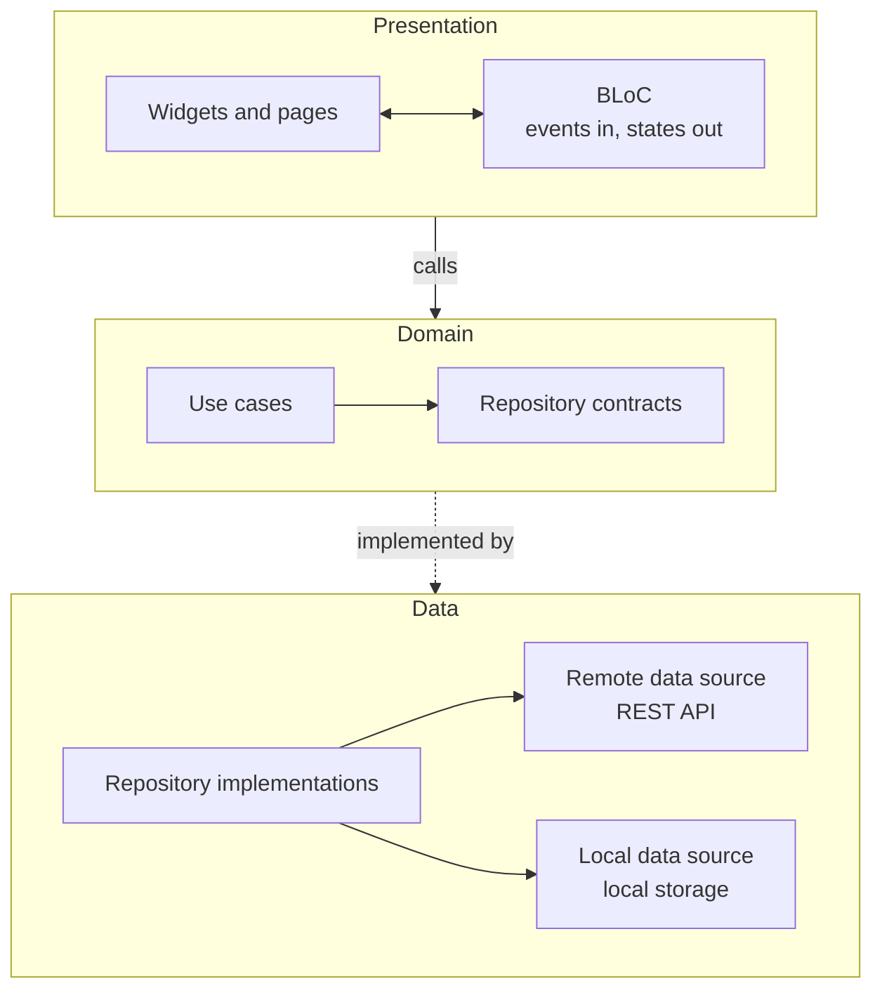

<div align="center">


<h1>Anas Alhelou</h1>

<p><b>Cross-Platform Developer | Flutter Specialist</b></p>

<p>
I specialize in mobile application development with Flutter and Dart.<br />
I focus on well-structured, maintainable apps and on turning product requirements and designs into reliable mobile experiences.
</p>

<a href="https://www.linkedin.com/in/anasalhelou"></a>
&nbsp;&nbsp;
<a href="mailto:anas.sh.alhilo@gmail.com"></a>

</div>

---

## Technical approach

Flutter lets one codebase serve several platforms. Clean Architecture keeps that codebase healthy as the product grows.

<table>
  <tr>
    <td width="50%" valign="top">

**Architecture and structure**

Clean Architecture, a feature-first structure and SOLID principles keep code organized and make applications easier to maintain and extend.

</td>
    <td width="50%" valign="top">

**State management and core features**

BLoC state management, REST API integration, local storage, authentication and offline-first functionality.

</td>
  </tr>
  <tr>
    <td width="50%" valign="top">

**Native awareness**

Hands-on experience with native Android, which helps me understand platform-specific functionality and how Flutter apps interact with native code.

</td>
    <td width="50%" valign="top">

**Version control and collaboration**

Git and GitHub in team environments: branching, pull requests, code reviews and resolving merge conflicts.

</td>
  </tr>
</table>

## How a feature is built

Each feature owns its three layers, so features stay independent and the app is easy to extend.



<details>
<summary>Folder layout</summary>

```text
lib/
├── core/                  # theme, router, shared widgets, utilities
└── features/
    └── <feature>/
        ├── data/          # models, data sources, repository implementations
        ├── domain/        # entities, repository contracts, use cases
        └── presentation/  # BLoC, screens, widgets
```

</details>

## Tools

<p align="center">
  
</p>

<p align="center">Also working with BLoC, REST APIs, local storage and native Android.</p>

## Selected work

| Project | About |
| --- | --- |
| [**RouteX**](https://github.com/m7m-tech/route_x) | Driver-side mobile app built by a Flutter team in Taqat Academy's CodeMap program. I designed the feature-based architecture and set up the base development environment. Built with Flutter, flutter_bloc and GoRouter. |
| [**Taskora CodeCenter**](https://github.com/anas-alhilo/taskora_codecenter) | Task management app on a feature-based architecture with SOLID principles. Built with Flutter, BLoC and SharedPreferences. In progress. |
| [**Grocery Plus**](https://github.com/anas-alhilo/grocery_plus) | Grocery shopping app built with Flutter. |

More projects are in my [repositories](https://github.com/anas-alhilo?tab=repositories).

## Open to connect

I'm always looking to improve my development skills, learn from real-world projects and find better ways to solve technical problems. I'd like to connect with teams and companies building cross-platform products where I can contribute to meaningful work.

- LinkedIn: [linkedin.com/in/anasalhelou](https://www.linkedin.com/in/anasalhelou)
- Email: [anas.sh.alhilo@gmail.com](mailto:anas.sh.alhilo@gmail.com)
